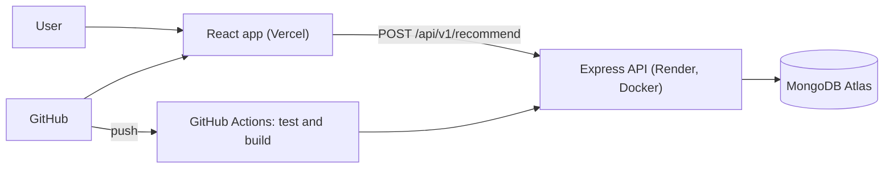

# FitFinder

**Find your size in every brand.** A medium in one store is a small in another. FitFinder takes your measurements once and shows your recommended size across 7 brands, with a confidence level for each.


**Live app:** <your Vercel URL> | **API docs:** <your Render URL>/docs

> The API runs on a free host that sleeps when idle, so the first request can be slow.


## Features

- Compare women's tops across 7 brands from one set of measurements
- Confidence level (high, medium, low) and a short note for every result
- Handles **body charts** and **garment charts** differently
- Snug, regular or loose fit
- Cards view, Compare table and a "most common size" summary
- Measurements saved in your browser only, plus a shareable link
- Responsive layout with dark mode
- REST API with validation and interactive Swagger docs
- Jest tests and a CI pipeline

## How the sizing works

The matching is a transparent rule-based algorithm (`api/src/services/matchSize.js`), with no machine learning.

- **Body charts** describe a person, so your measurements are compared directly with each size's range.
- **Garment charts** describe the clothing, so an assumed ease is added to your bust first: snug 4 cm, regular 8 cm, loose 14 cm. These are assumptions, and they are easy to change.
- Each size gets a score based on its distance from your measurements, and the closest size wins.
- **Confidence:** high when the winner clearly beats the runner-up, medium when two sizes are close, low when nothing fits well. Garment charts are capped at medium.

## Architecture



## Tech stack

React (Vite) · Node.js · Express · MongoDB Atlas · Mongoose · Jest · Swagger · Docker · GitHub Actions · Render · Vercel

## API

Interactive docs: `<your Render URL>/docs`

| Method | Endpoint | Description |
|---|---|---|
| GET | `/health` | Health check |
| GET | `/api/v1/brands` | List brands |
| GET | `/api/v1/brands/:slug/charts` | A brand's size charts |
| POST | `/api/v1/recommend` | Recommended size in every brand |

**Example**

```bash
curl -X POST <your Render URL>/api/v1/recommend \
  -H "Content-Type: application/json" \
  -d '{"bust": 89, "waist": 70, "fit": "regular"}'
```

`bust` is required (60 to 160 cm). `waist`, `hips` and `fit` (`snug`, `regular`, `loose`) are optional. Invalid input returns a 400 with a list of messages.

## Data

Seven brands, women's tops only, collected by hand from public marketplace size charts: Allen Solly, Max Fashion, Nike and Levi's (garment charts), and Biba, H&M and Vero Moda (body charts). Each chart in `api/src/seed/brands.json` records its source URL and the date it was retrieved.

The data is for demonstration, may differ from current brand charts, and the project is not affiliated with any brand.

## Run locally

Requires Node.js 20+ and a free MongoDB Atlas cluster.

```bash
git clone https://github.com/nalawadeakshata29/fitfinder.git
cd fitfinder/api
npm install
cp .env.example .env     # set MONGODB_URI (include the database name)
npm run seed
npm run dev              # http://localhost:5000, docs at /docs
```

In a second terminal:

```bash
cd fitfinder/web
npm install
echo "VITE_API_URL=http://localhost:5000" > .env
npm run dev
```

> `npm run seed` deletes and recreates all brands and charts in the database it connects to.

## Testing, Docker and CI/CD

```bash
cd api && npm test                      # Jest unit tests
node src/services/selfCheck.js          # checks every chart maps back to itself
docker build -t fitfinder-api . && docker run --env-file .env -p 5000:5000 fitfinder-api
```

On every push, GitHub Actions runs the API tests and Docker build, and the frontend lint and build. The API deploys to Render from its Dockerfile, the frontend deploys to Vercel, and secrets live only in the hosting dashboards. Free tiers change, so check each provider's current terms.

## Limitations

- Women's tops only, with 7 brands.
- Matching is per chart, not per product, so oversized and slim styles share one chart.
- Garment results rely on an assumed ease and can be one size off.
- Fabric stretch, body shape and taste are not modelled.
- Size data is collected manually and can go out of date.

## Roadmap

Men's charts · more brands and categories · reading size charts from screenshots with a vision model · optional accounts · frontend tests

## Author

**Akshata Nalawade** · [GitHub](https://github.com/nalawadeakshata29) · <your LinkedIn URL>

*Recommendations are estimates, so check the brand's own size guide before you buy.*
